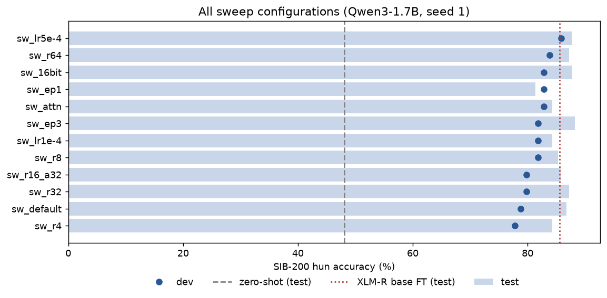

# Teaching a Small Language Model Your Language with LoRA

**Deep Learning Group Project, Milestones 1 and 2** · Our language: **Hungarian**

| Name | Neptun Code |
|---|---|
| Zhang JinJing | M5UG9O |
| Márton Németh | FXHRHX |
| Hussein Mnati Madhi | GN0GC8 |

Small language models are much worse in languages like Hungarian than in English. In this project we
try to improve one with cheap fine-tuning (LoRA). We use two benchmarks that exist in many languages:

* **SIB-200**: sort a sentence into one of 7 topics (science, travel, politics, sports, health,
  entertainment, geography). 701 training, 99 validation and 204 test sentences.
* **Belebele**: reading comprehension. Read a short text and answer a question with A, B, C or D. 900 questions.


---

## Repository layout

```
README.md                      this report
requirements.txt               library versions we used
milestone1/
  SIB200_Milestone1_Final.ipynb    English XLM-R run (Colab), with outputs
  sib200_milestone1_final.py       the same notebook as a .py file
  run_xlmr_sib200.py               the same pipeline as a script, used for the Hungarian run
  results/                         our results and the authors' results, per seed
milestone2/
  Milestone2.ipynb             the whole Milestone 2 experiment, with outputs
  m2_helper.py                 helper code used by the notebook (data, prompts, training, evaluation)
  results/
    runs.csv                   every run we did, with its settings and results
    tables.md                  all result tables
    plots/                     the figures below
```

---

## Milestone 1: Reproducing the XLM-R baseline

**Goal.** Reproduce the SIB-200 topic classification results of XLM-R base for English and for Hungarian:
train the model 5 times (seeds 1–5) on 701 training sentences, test on 204, and compare the average accuracy
with the authors' results (English 90.0%, Hungarian 86.0%).

**Data.** We download the authors' SIB-200 repository and load the train / validation / test files from
`data/annotated/eng_Latn` and `data/annotated/hun_Latn`. We check the dataset sizes and a few examples, and
use the original training code to tokenize the text for XLM-R base.

**Settings.** The exact XLM-R base command is not in the authors' repository, so we use the settings of their
`glot.sh` script (the Glot500 script mentioned in the assignment): 20 epochs, batch size 16 with gradient
accumulation 2 (effective batch 32), maximum sequence length 164, learning rate 1e-5, BF16 mixed precision.
English was trained on a Colab A100. Hungarian was trained on an RTX 3060 laptop GPU (6 GB) with batch size 8
and gradient accumulation 4, which keeps the effective batch size at 32.

**Compatibility fixes.** Four changes make the original code work with newer libraries:

1. Import `AdamW` from PyTorch instead of Transformers.
2. Replace `tokenizer.encode_plus()` with a direct tokenizer call.
3. Replace `pad_to_max_length=True` with `padding="max_length"`.
4. Use `torch.load(..., weights_only=False)` for the cached features.

**Training and evaluation.** Each run trains on the training set and is evaluated on the test set, and saves
its model, training log and results. The validation set is not used: the original script only checks it after
500 training steps, and our training has 440 (the authors' runs behave the same).

**Results** (test accuracy; the authors' per-seed numbers are from `outputs.zip` in their repository):

| Seed | English (ours) | English (authors) | Hungarian (ours) | Hungarian (authors) |
|---|---:|---:|---:|---:|
| 1 | 89.71% | 90.20% | 87.75% | 84.31% |
| 2 | 88.24% | 89.22% | 84.31% | 86.76% |
| 3 | 89.71% | 90.69% | 85.78% | 85.78% |
| 4 | 90.69% | 90.69% | 84.80% | 86.27% |
| 5 | 91.18% | 89.22% | 85.29% | 86.76% |
| **Average** | **89.90%** | **90.00%** | **85.59%** | **85.98%** |

Our averages are 0.10 (English) and 0.39 (Hungarian) percentage points below the authors'. That is less than
the difference between seeds, so we reproduced the baseline closely.

---

## Milestone 2: Improving Qwen3-1.7B with LoRA

### What we did

1. **Tested the model without training** (zero-shot).
2. **Fine-tuned it with LoRA** on the 701 Hungarian training sentences. LoRA trains a small add-on
   (about 1% of the model's size) instead of the whole model. We used the 4-bit version of the model
   (QLoRA), which needs much less memory. Our code is based on Unsloth's free Qwen3 Colab notebook.
3. **Tried 12 different LoRA settings** (one change at a time) and recorded GPU memory and training time.
   We picked the best setting using the validation set only, then trained it 3 times (seeds 1–3).

To evaluate, we check which of the possible answers (the 7 topics, or A/B/C/D) the model finds most likely.
This way the model always gives a valid answer, even before training. Everything ran on one laptop GPU
(RTX 3060, 6 GB).

### Why we expected these changes to help

| Change | Why we expected it to help |
|---|---|
| LoRA fine-tuning | The model already knows some Hungarian; it mostly needs to learn the task and the 7 labels. |
| 4-bit model (QLoRA) | Should use much less memory with little loss in accuracy. |
| Higher LoRA rank (bigger add-on) | More capacity, but with only 701 sentences the gain might be small. |
| Learning rate and number of epochs | Too little training underfits, too much overfits. |

### Results

Metric: **accuracy** = the percentage of test questions answered correctly. Hungarian SIB-200 test
set (204 sentences) unless noted.

| Method | Hungarian SIB-200 | English SIB-200 | Hungarian Belebele | GPU memory | Training time |
|---|---|---|---|---|---|
| XLM-R base, full fine-tuning (Milestone 1) | 85.6% | 89.9% | – | – | – |
| Qwen3-1.7B, no training | 48.0% | 50.5% | 37.5% | – | – |
| **Qwen3-1.7B + LoRA (best setting, 3 runs)** | **87.8%** | **91.2%** | **52.2%** | 3.0 GB | 2.2 min |

The LoRA model was trained only on Hungarian topic classification, yet it also improved on English and on
Belebele. (For Belebele we use a fixed set of 299 of its 900 questions for every method.)



### Comparing LoRA settings

The default setting was rank 16, 4-bit, learning rate 2e-4, 2 epochs. Each row changes one thing.

| Setting | Validation | Test | GPU memory | Training time |
|---|---|---|---|---|
| Default | 78.8% | 86.8% | 2.96 GB | 2.3 min |
| Rank 4 (smaller add-on) | 77.8% | 84.3% | 2.83 GB | 3.4 min* |
| Rank 8 | 81.8% | 85.3% | 2.88 GB | 2.6 min |
| Rank 32 | 79.8% | 87.3% | 3.12 GB | 2.5 min |
| Rank 64 (bigger add-on) | 83.8% | 87.3% | 3.47 GB | 2.6 min |
| Alpha 32 (stronger LoRA update) | 79.8% | 85.8% | 2.96 GB | 2.4 min |
| Only attention layers | 82.8% | 84.3% | 2.85 GB | 2.5 min |
| 16-bit instead of 4-bit | 82.8% | 87.8% | **4.85 GB** | 2.1 min |
| Learning rate 1e-4 | 81.8% | 84.3% | 2.96 GB | 2.2 min |
| **Learning rate 5e-4 (chosen)** | **85.9%** | 87.8% | 2.96 GB | 2.2 min |
| 1 epoch | 82.8% | 81.4% | 2.96 GB | 1.2 min |
| 3 epochs | 81.8% | 88.2% | 2.96 GB | 3.2 min |

\* The rank 4 run was probably slowed down by other programs on the laptop

---

## Discussion

### What worked

* **LoRA works very well.** Accuracy went from 48% to 87.8%, better than fully training XLM-R (85.6%),
  while training only 1% of the model for about 2 minutes.
* **4-bit (QLoRA) saves a lot of memory for free.** It needs 3.0 GB instead of 4.9 GB (39% less) with
  the same accuracy.
* **A small add-on is enough.** Rank 4 to rank 64 changes the test accuracy by only about 3%.
* **It helps in English too.** Trained only on Hungarian, the model also reached 91.2% in English.

### What did not work

* **Too little training was worse**: 1 epoch or a lower learning rate lost 3–6%.
* **Some settings were slightly worse than the default**: a stronger LoRA update (alpha 32) and training
  only the attention layers.
* **16-bit was not more accurate** than 4-bit, it just used more memory.
* **Reading comprehension improved less.** Belebele went from 37.5% to 52.2%, much less than topic
  classification, because we never trained on reading comprehension.
* **The untrained model ignores the answer format.** It writes full sentences ("The topic is
  science/technology") instead of just the label, which is why we evaluate by checking the most likely answer.

### Limitations

* **Small test sets.** With 204 test sentences, one sentence is 0.5%. Differences of 1–2% between settings
  can be luck, especially since each setting was trained only once.
* **The validation set is even smaller** (99 sentences), so it does not always pick the setting that is
  best on the test set (3 epochs got the best test score, 88.2%).
* **One model only.** Other models might behave differently.

---

## How to reproduce

**Local (what we used):** a CUDA GPU with at least 6 GB and Python 3.11.

```bash
uv venv .venv --python 3.11
uv pip install --python .venv --torch-backend=cu128 torch==2.11.0 torchvision==0.26.0
uv pip install --python .venv -r requirements.txt
```

1. **Milestone 1**
   * *English:* open `milestone1/SIB200_Milestone1_Final.ipynb` in Google Colab, choose an A100 (or another
     BF16-capable GPU) and click **Runtime → Run all**. It installs the libraries, downloads SIB-200, applies
     the fixes, trains the five models and shows the results. (The `.py` file next to it is an export of the
     notebook and was not tested on its own.)
   * *Hungarian* (about 20 minutes on a 6 GB GPU):
     `python milestone1/run_xlmr_sib200.py --lang hun_Latn --train_batch 8 --grad_accum 4`.
     This script does the same steps as the notebook, for any language.
2. **Milestone 2:** run `milestone2/Milestone2.ipynb` from top to bottom (about 2.5 hours from scratch).
   Each run is saved to `results/runs.csv`. Runs that are already there are not repeated, so the notebook
   can be restarted if it stops. The saved outputs were produced this way, so each run shows when it was
   originally trained.

**Google Colab:** open `milestone2/Milestone2.ipynb` with a GPU runtime and click *Run all*. The first cell
downloads this repository and installs Unsloth.

## References

* [SIB-200](https://github.com/dadelani/sib-200) ([paper](https://arxiv.org/abs/2309.07445)) and [Belebele](https://huggingface.co/datasets/facebook/belebele)
* [Unsloth](https://github.com/unslothai/unsloth) (we started from its free Qwen3 Colab notebook)
* [LoRA](https://arxiv.org/abs/2106.09685) and [QLoRA](https://arxiv.org/abs/2305.14314)
